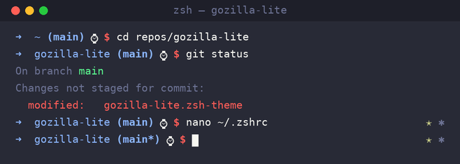

# gozilla-lite — a custom Oh My Zsh theme

A clean, minimal [Oh My Zsh](https://ohmyz.sh/) prompt based on the built-in
`gozilla` theme, tweaked for my everyday development environments. It shows the
current directory, git branch, and a live git status in the right-hand prompt.



## Features

- Minimal single-line prompt: `➜ dir (branch) ⌚ $`
- Current git branch shown inline
- Live working-tree status on the right prompt (added / modified / deleted /
  renamed / unmerged / untracked)
- Color-coded so state is readable at a glance

## Requirements

- [Zsh](https://www.zsh.org/)
- [Oh My Zsh](https://ohmyz.sh/)

## Installation

Drop the theme into your Oh My Zsh **custom** themes directory (recommended — it
won't be overwritten by Oh My Zsh updates):

```sh
curl -fsSL https://raw.githubusercontent.com/jannik-el/gozilla-lite/main/gozilla-lite.zsh-theme \
  -o "${ZSH_CUSTOM:-$HOME/.oh-my-zsh/custom}/themes/gozilla-lite.zsh-theme"
```

Then set the theme in `~/.zshrc`:

```sh
ZSH_THEME="gozilla-lite"
```

Reload your shell:

```sh
source ~/.zshrc
```

<details>
<summary>Alternative: install with <code>git clone</code></summary>

```sh
git clone --depth 1 https://github.com/jannik-el/gozilla-lite.git /tmp/gozilla-lite
cp /tmp/gozilla-lite/gozilla-lite.zsh-theme "${ZSH_CUSTOM:-$HOME/.oh-my-zsh/custom}/themes/"
rm -rf /tmp/gozilla-lite
```

</details>

## Prompt legend

| Symbol | Meaning        | Color   |
| :----: | -------------- | ------- |
|   ✈    | Added          | cyan    |
|   ✭    | Modified       | yellow  |
|   ✗    | Deleted        | red     |
|   ➦    | Renamed        | blue    |
|   ✂    | Unmerged       | magenta |
|   ✱    | Untracked      | grey    |

## Credits

Based on the `gozilla` theme that ships with
[Oh My Zsh](https://github.com/ohmyzsh/ohmyzsh), originally created by
[Irakli Gozalishvili](https://github.com/Gozala) in 2010.

## License

Released under the [MIT License](LICENSE).
